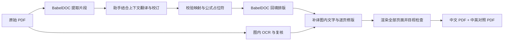

# BabelDOC 精校 PDF 翻译

**让 AI 负责理解与校译，让 BabelDOC 负责 PDF 解析和回填，再把图内文字与版式检查补齐。**

一个可安装的 Codex Skill，以及配套的本地 Python 工具。面向英文课件、论文和技术 PDF，生成保留图表、公式与页面结构的中文译本和中英逐页对照本。

这不是无人值守的一键翻译器。它把一次成功处理 81 页计算机网络课件的经验，整理成可复用、可检查、可续做的工作方法。

## 为什么还需要这一步

| 问题 | 本项目的处理方式 |
| --- | --- |
| 译文是否理解领域含义？ | 助手结合原页语境生成译文，统一术语并校订表达 |
| 图片里的英文是否真的翻了？ | 对图像区域 OCR，结合原图复核后局部回填 |
| 译文放回去是否还能读？ | 渲染全部页面，检查重叠、断句、裁切、公式和表头，再按页修版 |

直接保留图片，常常也保留了图片里的英文。即使正文翻得很好，图中的接口名称、表头、流程说明仍可能没有翻译。

实际案例中，单独运行 BabelDOC 仍会保留某页转发表图片中的英文；最终中文版补齐这些文字，依靠的是 OCR、译文复核和局部修版。[案例与比较边界](references/validated-case.md)

## 工作流程



## 作为 Codex Skill 使用

将本仓库放入个人技能目录，目录名保持为 `babeldoc-reviewed-translation`。默认目录为 `~/.codex/skills`；若设置了 `CODEX_HOME`，使用其下的 `skills`。

macOS / Linux：

```bash
git clone https://github.com/huazk/babeldoc-reviewed-translation.git \
  "${CODEX_HOME:-$HOME/.codex}/skills/babeldoc-reviewed-translation"
```

Windows PowerShell：

```powershell
$skillRoot = if ($env:CODEX_HOME) {
    Join-Path $env:CODEX_HOME 'skills'
} else {
    Join-Path $env:USERPROFILE '.codex/skills'
}
git clone https://github.com/huazk/babeldoc-reviewed-translation.git `
    (Join-Path $skillRoot 'babeldoc-reviewed-translation')
```

若同名目录已存在，先保留自己的修改，不要直接覆盖。安装后在可发现该技能的新会话中附上 PDF，并说：

> 使用 $babeldoc-reviewed-translation 翻译这份 PDF，保留图表公式，补译图内文字并逐页检查，生成中文和中英对照版本，不调用外部翻译平台。

完整工作约定见 [SKILL.md](SKILL.md)。

## 单独使用工具

已实测的核心组合为 Python 3.12、BabelDOC 0.6.4、PyMuPDF 1.25.2；OCR 使用 RapidOCR。建议创建独立环境：

```bash
python -m venv .venv
# 激活虚拟环境后：
python -m pip install -r requirements.txt
# 需要图内 OCR 时再安装：
python -m pip install -r requirements-ocr.txt
```

以下命令中的 `input.pdf` 是你自己的文件；`work` 保存中间结果。首次准备模型和字体可能需要联网：

```bash
python scripts/file_bridge.py assets --work work --assets assets
python scripts/file_bridge.py collect --input input.pdf --work work --assets assets
```

根据 `work/source-index.json`，由助手或译者填写完整的 `work/translations.json`：

```json
{
  "Forwarding table": "转发表",
  "Link cost <b0>": "链路代价 <b0>",
  "TCP": "TCP"
}
```

允许保留的原文还需要在 `work/keep.json` 中说明理由：

```json
{
  "TCP": "协议缩写，保留原文"
}
```

示例仅说明格式，不能替代当前 PDF 的完整映射。脚本不会自行产生译文，也不会调用翻译服务。

```bash
python scripts/file_bridge.py check --work work
python scripts/file_bridge.py render --input input.pdf --work work --assets assets
python scripts/pdf_review.py ocr --input input.pdf --out work/ocr.json
```

OCR 结果是待复核候选，**不会自动覆盖原图**。完成图内补译和当前文档的局部排版修复后，将最终译本记为 `final-mono.pdf`：

```bash
python scripts/pdf_review.py qa --input final-mono.pdf --out work/qa
python scripts/pdf_review.py dual --input input.pdf --translated final-mono.pdf --out final-dual.pdf
python scripts/pdf_review.py verify --input input.pdf --translated final-mono.pdf --dual final-dual.pdf --all-pages
```

检查器核对页数、页面尺寸与对照版拼接结果；译文准确性和版面质量仍须结合原文目视检查。详细参数、Windows 兼容处理和修版方法见 [实现参考](references/implementation.md)。

## 数据与使用边界

- 默认不把 PDF 上传到翻译网站，不调用 Bing、Google、沉浸式翻译或其他翻译 API。
- PDF 解析、OCR、回填和排版在本机运行；使用 Codex 时，语言理解和译文生成仍由当前助手完成，**不等于离线本地大模型**。
- 首次安装依赖、下载模型和字体可能联网。本项目没有实现网络隔离。
- 公式占位符缺失、空译文、缺项和无理由的原样保留会被拒绝；这些检查不等于数学或语义正确性证明。
- 复杂背景、旋转页、扫描件和密集图表需要按文档判断。不要用 OCR 误识别结果改写原公式。
- 本仓库不包含案例课件、译后 PDF、个人路径、账号凭据、模型权重或字体。

## 验证

```bash
python -m unittest discover -s tests -v
```

自动测试覆盖映射缺失、重复键、占位符保护、双语页序与像素核对、尺寸不匹配以及源文件覆盖保护。GitHub Actions 仅运行这些轻量检查，不下载布局模型，也不调用翻译服务。

另使用三张真实课件页测试过 BabelDOC 提取与文件回填、图内 OCR、渲染和双语输出。它证明核心工具能运行，不代表任意文档都可自动达到同等翻译质量。

## 致谢与许可证

本项目是独立的工作流与适配工具，不是 BabelDOC、PDFMathTranslate 或 Codex 的官方项目。

- [BabelDOC](https://github.com/funstory-ai/BabelDOC)：PDF 解析、布局与回填。
- [PyMuPDF](https://github.com/pymupdf/PyMuPDF)：PDF 检查、渲染与双语拼接。
- [RapidOCR](https://github.com/RapidAI/RapidOCR)：图中文字识别。
- [PDFMathTranslate-next](https://github.com/PDFMathTranslate/PDFMathTranslate-next)：同样使用 BabelDOC 的完整翻译应用。

本仓库原创代码与文档采用 [MIT License](LICENSE)。第三方项目、模型、字体及用户提供的文档各自遵循其许可证或使用条件，本仓库许可证不替代它们。
